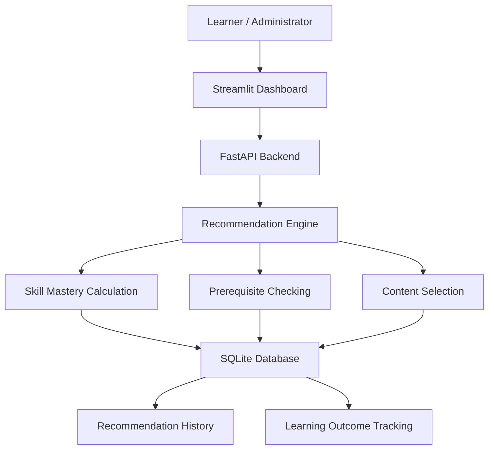

# Personalized Learning Recommendation System

## 1. About the Project

The Personalized Learning Recommendation System is a Python-based application that recommends learning activities to learners based on their assessment performance and skill levels.

The main idea behind this project is to help learners identify which skills they need to improve and what learning content they should study next.

The system checks assessment history, calculates skill mastery, verifies prerequisites, and selects suitable learning content based on difficulty.

It also stores recommendation history and records learner outcomes without deleting previous records.

**Note:** This project currently uses a rule-based recommendation approach. It does not use a trained machine learning model.

## 2. Problem Statement

Every learner has a different level of understanding. Some learners may understand a topic quickly, while others may need more practice.

Providing the same learning content to everyone may not be effective.

To address this, I developed a system that checks learner performance and recommends suitable learning activities based on their current skill level.

## 3. Technologies Used

| Technology | Usage |
|---|---|
| Python | Main programming language |
| FastAPI | Backend API development |
| Uvicorn | Running the API server |
| SQLite | Storing project data |
| Streamlit | Creating the dashboard |
| Pytest | Testing the application |
| Git and GitHub | Project version control |

## 4. Main Features

- Calculates learner skill mastery using assessment scores.
- Checks whether required prerequisites are completed.
- Recommends learning content based on skill level.
- Selects Easy, Medium, and Hard difficulty levels.
- Provides reasons for each recommendation.
- Stores recommendation history.
- Records learning outcomes without overwriting old records.
- Includes data validation and anomaly detection.
- Evaluates recommendations using a temporal holdout approach.
- Provides a dashboard for viewing learner and administrator information.
- Checks dataset reproducibility using SHA-256 checksums.

## 5. How the System Works

The application follows these steps:

1. Learner assessment information is retrieved from the database.
2. The system calculates mastery for each skill.
3. It checks the prerequisites for the required skills.
4. It identifies skills that need improvement.
5. Suitable learning content is selected based on mastery.
6. Recommendations are ranked and displayed.
7. Recommendation outcomes are saved in the database.

The recommendation engine also provides an explanation for why each learning activity is recommended.

## 6. System Architecture

The project follows a simple architecture where the Streamlit dashboard communicates with the FastAPI backend. The backend uses the recommendation engine to process learner information and stores the results in SQLite.



## 7. Project Structure

```text
Personalized-Learning-Recommendation-System/
│
├── anomaly_checks.py
├── dashboard.py
├── database.py
├── evaluate_recommendations.py
├── generate_data.py
├── main.py
├── recommendation.py
├── reproducibility.py
├── schema.sql
├── validation.py
├── requirements.txt
├── README.md
├── learning.db
│
├── tests/
│   ├── conftest.py
│   └── test_project.py
│
├── outputs/
│   ├── anomaly_cases.csv
│   ├── ground_truth.csv
│   ├── data_dictionary.json
│   ├── source_manifest.json
│   ├── evaluation_metrics.json
│   ├── reproducibility_report.json
│   ├── validation_summary.json
│   └── test_summary.txt
│
└── data/
    └── Generated CSV input files
```

## 8. Dataset Information

For this project, I generated a synthetic dataset using Python.

The generator uses a fixed random
