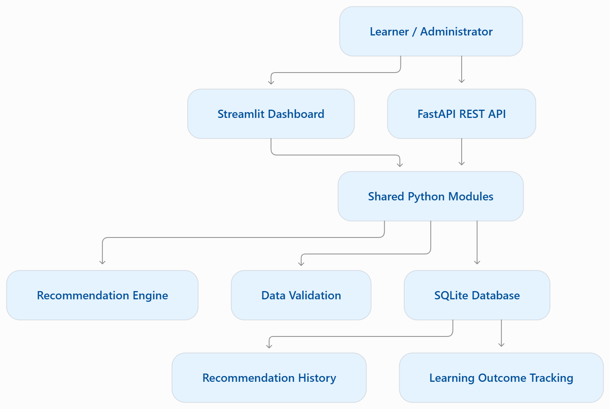

# Personalized Learning Recommendation System

## 1. About the Project

The Personalized Learning Recommendation System is a Python-based application that recommends learning activities based on a learner's assessment performance and skill levels.

The main goal of this project is to help learners understand which skills they need to improve and what learning content they should focus on next.

The system checks assessment history, calculates skill mastery, verifies prerequisites, and selects suitable learning content based on the learner's current level.

It also maintains recommendation history and records learning outcomes without deleting previous records.

**Note:** This project currently uses a rule-based recommendation approach. It does not use a trained machine learning model.

## 2. Problem Statement

Every learner has a different level of understanding. Some learners understand a topic quickly, while others need more time and practice.

Providing the same learning content to everyone may not be effective.

To address this problem, I developed a system that checks learner performance and recommends suitable learning activities based on their current skill levels.

## 3. Technologies Used

| Technology | Usage |
|---|---|
| Python | Main programming language |
| FastAPI | Backend API development |
| Uvicorn | Running the API server |
| SQLite | Database management |
| Streamlit | Creating the dashboard |
| Pytest | Testing the application |
| Git and GitHub | Version control |
| Git LFS | Managing the large database file |

## 4. Main Features

- Calculates learner skill mastery using assessment scores.
- Checks whether required prerequisites are completed.
- Recommends learning content based on skill levels.
- Selects Easy, Medium, and Hard difficulty levels.
- Provides reasons for each recommendation.
- Stores recommendation history.
- Records learning outcomes without overwriting previous records.
- Includes data validation and anomaly detection.
- Evaluates recommendations using a temporal holdout approach.
- Provides a dashboard for viewing learner and administrator information.
- Checks dataset reproducibility using SHA-256 checksums.

## 5. How the System Works

The application follows these steps:

1. Learner assessment information is retrieved from the database.
2. The system calculates mastery for each skill.
3. It checks the prerequisites for the required skills.
4. It identifies skills that need improvement.
5. Suitable learning content is selected based on mastery.
6. Recommendations are ranked and displayed.
7. Recommendation outcomes are saved in the database.

The recommendation engine also provides an explanation for why each learning activity is recommended.

## 6. System Architecture

The project has two interfaces: a Streamlit dashboard and a FastAPI REST API. Both interfaces use shared Python modules for recommendation logic, data validation, and database operations. SQLite stores learner information, recommendations, and learning outcomes.




## 7. Project Structure

```text
Personalized-Learning-Recommendation-System/
│
├── anomaly_checks.py
├── dashboard.py
├── database.py
├── evaluate_recommendations.py
├── generate_data.py
├── main.py
├── recommendation.py
├── reproducibility.py
├── schema.sql
├── validation.py
├── requirements.txt
├── README.md
├── learning.db
│
├── tests/
│   ├── conftest.py
│   └── test_project.py
│
├── outputs/
│   ├── anomaly_cases.csv
│   ├── ground_truth.csv
│   ├── data_dictionary.json
│   ├── source_manifest.json
│   ├── evaluation_metrics.json
│   ├── reproducibility_report.json
│   ├── validation_summary.json
│   └── test_summary.txt
│
└── data/
    └── Generated CSV input files (created locally)
```

## 8. Dataset Information

For this project, I generated a synthetic dataset using Python.

The data generator uses a fixed random seed (`20261022`) so that the dataset can be generated again with consistent results.

The full dataset contains:

| Dataset | Number of Records |
|---|---:|
| Learners | 10,000 |
| Courses | 1 |
| Skills | 500 |
| Skill prerequisites | 166 |
| Content items | 2,000 |
| Content-skill mappings | 2,000 |
| Assessment attempts | 500,000 |
| Assessment results | 500,000 |
| Learning paths | 10,000 |

The dataset includes learner assessment history, repeated attempts, different content formats, prerequisite gaps, and chronological assessment records.

All records are synthetic. No external personal data is used.

## 9. Recommendation Logic

The system calculates skill mastery using the average of assessment attempt scores for each skill.

### Mastery-Based Difficulty Selection

| Skill Mastery | Recommended Difficulty |
|---|---|
| Below 40% | Easy |
| 40% to below 70% | Medium |
| 70% to below 80% | Hard |
| 80% or above | Not recommended for ordinary progression |

A skill is eligible for recommendation only when all its direct prerequisites have at least 70% mastery.

### Recommendation Ranking

The ranking score is calculated using:

```python
(100 - mastery) * 0.7 + difficulty_weight * 4
```

Difficulty weights:

- Easy: 1
- Medium: 3
- Hard: 5

Each recommendation includes a reason code, explanation, ranking score, skill, content format, and estimated duration.

The system also supports an `as_of` cutoff so that future assessment attempts are excluded from historical mastery calculations.

## 10. Evaluation Results

I implemented temporal holdout evaluation to check how the recommendation system performs.

The assessment history is divided chronologically:

- First 80% of attempts are used as the training/history period.
- Final 20% of attempts are used as the future holdout period.

Recommendations are generated using only training-period information. Future assessment attempts are used only to determine relevance labels.

The evaluation uses three metrics:

- Precision@K
- Recall@K
- HitRate@K

### Current Baseline Results

The checked-in baseline uses 250 candidate learners, with 249 evaluated learners and K=5.

| Metric | Result |
|---|---:|
| Precision@5 | 0.0177 |
| Recall@5 | 0.0175 |
| HitRate@5 | 0.0843 |

These results come from synthetic data. The scores are relatively low because the generated assessment attempts assign skills randomly rather than representing a strong next-skill learning sequence.

These results should be considered a baseline evaluation, not proof of real-world learning improvement.

### Run Evaluation

```powershell
python evaluate_recommendations.py --k 5 --holdout 0.2 --limit-learners 250
```

The results are saved in:

`outputs/evaluation_metrics.json`

## 11. Data Validation and Anomaly Detection

I included validation checks to identify incorrect or inconsistent records.

The system checks:

- Primary-key uniqueness.
- Foreign-key integrity.
- Invalid assessment scores.
- Missing assessment results.
- Timestamp ordering.
- Assessment-result reconciliation.
- Outcome score ranges.
- Ground-truth consistency.
- Separation of anomaly records from normal data.

### Anomaly Scenarios

I tested five deliberate anomaly scenarios:

1. Prerequisite violation.
2. Invalid timestamp.
3. Invalid skill reference.
4. Future-data leakage.
5. No-progress loop.

The validation results can also be accessed through the API:

```text
GET /validation
```

## 12. API Endpoints

The project uses FastAPI to provide REST API endpoints.

| Method | Endpoint | Purpose |
|---|---|---|
| GET | `/` | Application status |
| GET | `/learners` | Retrieve learners |
| GET | `/learners/{learner_id}/mastery` | View learner skill mastery |
| GET | `/learners/{learner_id}/recommendations` | Get learning recommendations |
| POST | `/attempts` | Record assessment attempts |
| POST | `/outcomes` | Record a new learning outcome |
| GET | `/recommendations/{recommendation_id}/outcomes` | View outcome history |
| GET | `/metrics` | Retrieve project metrics |
| GET | `/validation` | Run data validation |
| GET | `/recommendation-history/{learner_id}` | View recommendation history |

### Example Outcome Request

```json
{
  "recommendation_id": "PASTE_A_REAL_RECOMMENDATION_ID",
  "outcome_score": 82,
  "outcome_type": "ASSESSMENT",
  "notes": "Completed the recommended activity"
}
```

Use an actual recommendation ID returned by the recommendation endpoint or dashboard.

Each outcome is stored as a new event. Previous outcome records are not overwritten.

## 13. Installation and Running the Project

### Requirements

- Python 3.10 or later
- Visual Studio Code
- Git
- Git LFS

### Step 1: Install Git LFS

Install Git LFS on your computer from:

https://git-lfs.com/

After installation, open PowerShell and run:

```powershell
git lfs install
```

### Step 2: Clone the Repository

```powershell
git clone https://github.com/Jagadeesh765/Personalized-Learning-Recommendation-System.git
```

Move into the project folder:

```powershell
cd Personalized-Learning-Recommendation-System
```

Download the large database file managed by Git LFS:

```powershell
git lfs pull
```

### Step 3: Create a Virtual Environment

```powershell
python -m venv venv
```

### Step 4: Activate the Environment

```powershell
.\venv\Scripts\Activate.ps1
```

### Step 5: Install Required Packages

```powershell
python -m pip install -r requirements.txt
```

### Step 6: Start the FastAPI Backend

Open the first terminal and run:

```powershell
python -m uvicorn main:app --reload
```

Backend URL:

http://127.0.0.1:8000

API documentation:

http://127.0.0.1:8000/docs

### Step 7: Start the Streamlit Dashboard

Open a second terminal and run:

```powershell
python -m streamlit run dashboard.py
```

Dashboard URL:

http://localhost:8501

Keep both terminals running while using the application.

**Important:** The repository includes an initialized SQLite database, so you can start the application without generating the dataset again.

Do not run `python database.py --reset` unless you intentionally want to rebuild the database. This operation is destructive and can remove existing recommendation and outcome history.

## 14. Reproducibility Verification

I also included a script to check whether the generated dataset is reproducible.

The script generates the dataset twice in separate temporary folders and compares row counts and SHA-256 checksums.

Run:

```powershell
python reproducibility.py --scale full
```

For a quicker check:

```powershell
python reproducibility.py --scale starter
```

The report is saved in:

`outputs/reproducibility_report.json`

## 15. Automated Testing

I used Pytest to test the main project functionality.

Run the following command:

```powershell
python -m pytest -v
```

The tests cover:

- Assessment time cutoffs.
- Recommendation reason codes.
- Append-only outcome history.
- Temporal evaluation.
- Deterministic data generation.
- Ground-truth separation.
- Database integrity.
- All five anomaly scenarios.

**Current test result: 15 tests passed.**

## 16. Limitations and Future Improvements

### Current Limitations

- The recommendation engine uses predefined business rules.
- A trained machine learning model is not currently implemented.
- The evaluation uses synthetic assessment data.
- Real-world recommendation performance has not yet been established.

### Future Improvements

- Add machine-learning-based recommendation techniques.
- Explore content-based and collaborative filtering.
- Improve recommendations using learner feedback.
- Test the system with real-world learning datasets.
- Add more learner progress visualizations.
- Compare rule-based and machine-learning recommendation approaches.

## 17. GitHub Repository

The complete source code and project files are available here:

**GitHub Repository:**

https://github.com/Jagadeesh765/Personalized-Learning-Recommendation-System

---

**Developed using Python, FastAPI, Streamlit, and SQLite.**
